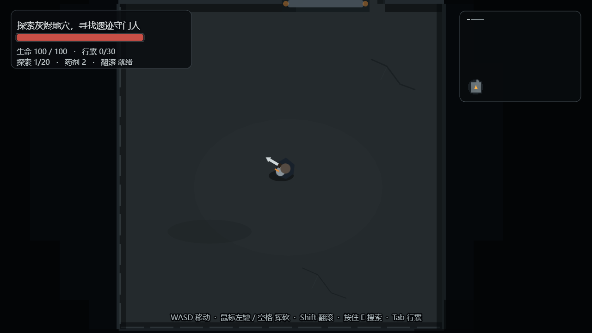

# 灰烬地穴（Ashen Vault）

单机 PvE 暗黑式搜打撤网页游戏的第一个可玩原型。



## 当前版本

- 7040 × 4864 像素的大型程序化地牢
- 20 个房间、分支走廊和循环捷径
- “铁誓猎人”近战角色
- WASD 移动、鼠标/空格挥砍、Shift 翻滚、E 使用药剂
- 三类普通敌人与首领“遗迹守门人”
- 普通探索时固定视野与镜头比例
- 进入首领区域后平滑拉远镜头并扩大视野
- 战争迷雾和只显示已探索区域的小地图
- 连续地面、立体墙体、墙脚阴影、门槛与环境磨损组成的非像素化矢量美术
- 15 个地图宝箱与击败 Boss 后出现的守门人宝库
- 长按搜索、搜索进度、开盖回弹、发光与粒子反馈
- `6×5` 格子背包以及 `1×1 / 1×2 / 2×1 / 2×2` 战利品
- 普通、魔法、稀有三档战利品及价值取舍
- 击败首领后开启撤离传送门

## 本地运行

```bash
npm install
npm run dev
```

生产构建：

```bash
npm run build
```

## 操作

| 按键 | 行为 |
|---|---|
| `WASD` | 移动 |
| 鼠标左键 / `Space` | 向鼠标方向挥砍 |
| `Shift` | 翻滚并获得短暂无敌 |
| 按住 `E` | 搜索宝箱 |
| `E` | 查看已开启宝箱、使用药剂或撤离 |
| `Tab` | 打开或关闭行囊 |
| `Esc` | 关闭战利品界面 |
| `R` | 胜利或失败后重新开始 |

## 技术栈

- Phaser 3
- TypeScript
- Vite

当前角色、怪物、场景和特效均为程序化占位美术，后续可以在不改变碰撞和玩法数据的情况下替换为正式精灵图集。
